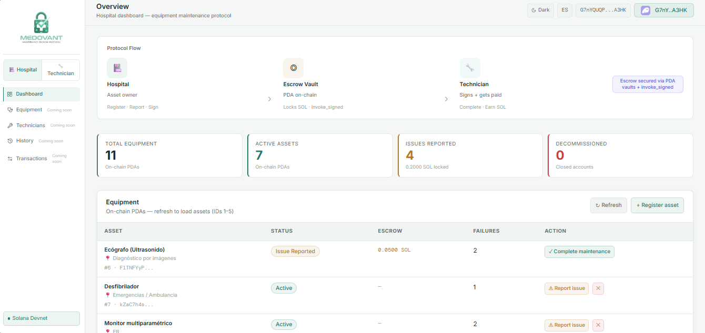
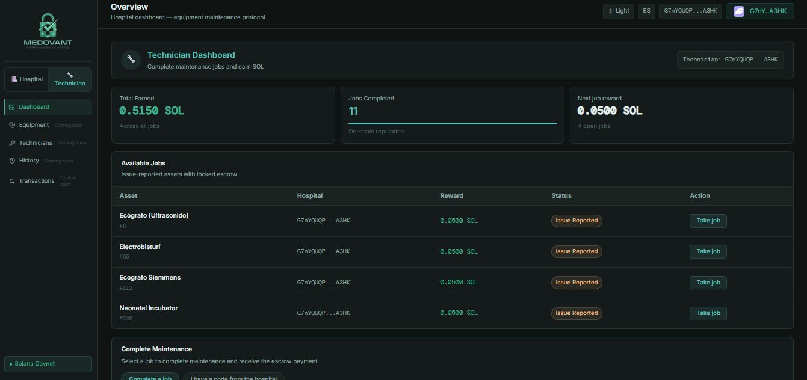

<div align="center">


# MEDOVANT PROTOCOL

### *Verifiable infrastructure for critical medical equipment maintenance*

[](https://explorer.solana.com/address/5JMd8ADy1KHBhohX6NLbz6WQdyCQTfLd55Gmzo2r34WD?cluster=devnet)
[](https://www.anchor-lang.com/)
[](https://www.rust-lang.org/)
[](https://react.dev/)
[](https://www.typescriptlang.org/)
[](https://vite.dev/)
[](https://tailwindcss.com/)

<br/>

**[🌐 Live demo](https://medovant-protocol.vercel.app/)** &nbsp;·&nbsp;
**[▶️ Demo video](https://youtu.be/QcnXvDtaz0g)** &nbsp;·&nbsp;
**[🎤 Pitch video](https://youtu.be/oIOFPkzTNq4)** &nbsp;·&nbsp;
**[🔍 Solana Explorer](https://explorer.solana.com/address/5JMd8ADy1KHBhohX6NLbz6WQdyCQTfLd55Gmzo2r34WD?cluster=devnet)** &nbsp;·&nbsp;
**[📂 Docs](docs/)**

<br/>

🎓 Medovant participated in the Solana Latam Labs incubation program (WayLearn · Solana Foundation, 2026).

</div>

---

## Summary

Even where maintenance software exists, the proof that a repair was done often
ends up in paper forms, spreadsheets and chat messages. The hospital pays
without a record that anyone else can check.

Medovant puts that proof on Solana: each piece of equipment is an on-chain
identity, payment is locked in escrow when an issue is reported, and it is
released only when hospital and technician both confirm completion. Every
completed job builds the technician's on-chain reputation, and anyone can
verify the payment and reputation history on-chain. This is a
**Devnet prototype**. Instructions, PDAs and seeds are in
[Architecture](#architecture).

---

## Problem

Maintenance of critical medical equipment — ventilators, imaging systems,
diagnostic devices — is managed with a mix of software, paper forms,
spreadsheets and messaging apps. Verifying that a job was actually done often
depends on a phone call, a chat message or a signed sheet. That evidence sits
with whoever kept it, and nobody else can independently check it.

| Actor | Problem today |
|-------|---------------|
| 🏥 **Hospital / clinic** | Often pays for maintenance without an independent way to verify the work was done |
| 🔧 **Biomedical technician** | Has no portable, verifiable record of completed work across different clients |
| 📋 **Independent reviewer** | Has no maintenance history to consult that does not depend on someone's internal system |

> Note: late or disputed payments between hospitals and technicians are a
> hypothesis we have not validated.

---

## Demo

 🌐 [Live app](https://medovant-protocol.vercel.app/)

#### Hospital dashboard


#### Technician dashboard


---

## Protocol flow

```
┌────────────────────────────────────────────────────────────────────────────┐
│      │                               │                              │      │
│  HOSPITAL                  PROGRAM + VAULT PDA                 TECHNICIAN  │
│      │                               │                              │      │
│      │  1. initialize_asset          │  asset PDA created           │      │
│      │──────────────────────────────►│                              │      │
│      │                               │                              │      │
│      │  2. report_issue(reward)      │  SOL locked in the vault     │      │
│      │──────────────────────────────►│                              │      │
│      │                               │  (released only by           │      │
│      │                               │   complete_maintenance)      │      │
│      │                               │                              │      │
│      │  3. hospital signs            │  technician signs            │      │
│      │──────────────────────────────►│                              │      │
│      │                               │◄─────────────────────────────│      │
│      │                               │  complete_maintenance        │      │
│      │                               │                              │      │
│      │                               │  SOL released                │      │
│      │                               │─────────────────────────────►│      │
│      │                               │                +1 reputation │      │
│      │                               │                              │      │
└────────────────────────────────────────────────────────────────────────────┘
```

---

## Why Solana?

<table>
<tr>
<td align="center" width="33%">

**🚀 Speed**

Fast confirmations. Maintenance workflows should not wait on slow settlement.

</td>
<td align="center" width="33%">

**💰 Cost**

Low per-transaction fees, which makes recording many assets practical.

</td>
<td align="center" width="33%">

**🔐 Native escrow**

System-owned vault PDA with `invoke_signed`. No extra contracts, no intermediaries.

</td>
</tr>
</table>

Why not a regular database? Because hospital, technician and reviewer would
each have to trust whoever runs it. On a public chain, the payment rules and
the on-chain record do not belong to any of them.

---

## Business and impact

**Who it serves.** Hospitals and clinics that outsource maintenance of
critical equipment, and the independent biomedical technicians they hire.

**Business model (where we aim to go; not implemented yet).**

| Stage | Model we aim for |
|-------|------------------|
| Pilot | Free pilots with 1–2 healthcare organizations |
| Growth | Monthly subscription per organization, tiered by number of registered assets |
| Scale | Fee per escrow transaction, plus protocol licensing to maintenance platforms that integrate it as a verification layer |

End users should not need to manage wallets; wallet abstraction is planned for
v2.0.

**Not yet validated.** Willingness to pay, and fit with local regulation for
medical equipment and data protection. These come before approaching any
clinic.

**Impact if it works.** Equipment with a verifiable service history is easier
to audit, and technicians gain a track record that does not depend on any one
client's records.

**Ecosystem impact.** Medovant is an open-source Solana program with documented
instructions and a verifiable build, so other maintenance or asset-tracking
projects can study it or reuse the escrow and reputation pattern.

---

## Architecture

```
                 Wallet (Phantom)
                        │
                        ▼
        React Frontend (Vite + TypeScript + Tailwind)
        Hospital Mode · Technician Mode
              │                       │
   signs and sends               reads and writes
   transactions                  metadata and files
              │                       │
              ▼                       ▼
   ┌─────────────────────┐   ┌─────────────────────────┐
   │ ON-CHAIN (Solana)   │   │ OFF-CHAIN (Supabase)    │
   │                     │   │                         │
   │ Anchor program      │   │ Asset names             │
   │                     │   │ Maintenance evidence    │
   │ Asset PDA           │   │ SHA-256 hash of each    │
   │ Vault PDA (escrow)  │   │ evidence file           │
   │ TechnicianProfile   │   │                         │
   │ PDA                 │   │                         │
   └─────────────────────┘   └─────────────────────────┘
```

| Account | Seeds |
|---------|-------|
| Asset PDA | `["equipment", hospital, asset_id]` |
| Vault PDA (system-owned escrow) | `["vault", asset_pda]` |
| TechnicianProfile PDA | `["technician", tech_pubkey]` |

The stored hash lets a reviewer detect changes to an evidence file by comparing
it with the reference. It does not prove when the evidence was created or that
its content is true.

→ Full architecture: [docs/ARCHITECTURE.md](docs/ARCHITECTURE.md)
→ Asset lifecycle and escrow diagrams: [docs/ARCHITECTURE.md#asset-lifecycle-and-escrow-flow](docs/ARCHITECTURE.md#asset-lifecycle-and-escrow-flow)

---

## Smart contract instructions

| Instruction | Signers | Effect |
|-------------|---------|--------|
| `register_technician` | 🔧 Technician | Creates the TechnicianProfile PDA |
| `initialize_asset(asset_id)` | 🏥 Hospital | Creates the Asset PDA · status = Active |
| `report_issue(reward)` | 🏥 Hospital | Locks the reward in the Vault PDA · `failure_count` + 1 |
| `complete_maintenance` | 🏥 + 🔧 Both | Dual signature · releases the escrow · updates reputation |
| `decommission_asset` | 🏥 Hospital | Closes the Asset PDA · rent returns to the hospital |

### Dual-signature `complete_maintenance` (PST hand-off)

`complete_maintenance` requires **two signatures**: the hospital's (it pays the
fees) and the technician's (it executes). The same wallet can act as both on
its own assets, so one wallet is enough to try the full flow. When the hospital
and the technician are different parties, the protocol uses a **partially
signed transaction (PST) hand-off** so neither shares a private key:

- The hospital builds and partially signs → exports a JSON payload.
- The technician verifies it (re-derives the PDAs, checks the invariants) →
  adds a signature → submits.

Details: [`docs/PST_HANDOFF.md`](docs/PST_HANDOFF.md)

---

## Escrow and security

The vault is a system-owned PDA funded by `report_issue`. The locked reward
moves only through `complete_maintenance`, signed with `invoke_signed`, and
`decommission_asset` is rejected while an issue is pending. Access is enforced
with Anchor constraints (`has_one`, status checks, reward validation, PDA seed
validation) and a mandatory dual signature on `complete_maintenance`.

The program embeds `security.txt` metadata. Details:
[docs/ARCHITECTURE.md](docs/ARCHITECTURE.md) and
[docs/SECURITY.md](docs/SECURITY.md). This is an unaudited prototype; see
[Limitations](#limitations).

---

## Frontend

<table>
<tr>
<td width="50%">

**🏥 Hospital Mode**
- Dashboard with on-chain KPIs
- Medical asset registration and management
- Issue reporting with locked funds
- Maintenance verification and approval

</td>
<td width="50%">

**🔧 Technician Mode**
- Verifiable on-chain earnings
- Completed jobs with on-chain reputation
- Available orders backed by escrow
- Complete & Get Paid flow

</td>
</tr>
</table>

Light/dark mode · Bilingual EN/ES · Responsive · Wallet adapter (Phantom)

---

## How to run

**Live app:** [medovant-protocol.vercel.app](https://medovant-protocol.vercel.app/)
runs on Solana Devnet. Connect a Phantom wallet set to Devnet, with some Devnet
SOL for fees. A single wallet can switch between the Hospital and Technician
roles and try the full flow on its own assets. Completing a job for another
hospital needs two wallets and the PST hand-off (see the
[demo video](https://youtu.be/QcnXvDtaz0g)).

Asset names and evidence files are stored off-chain in Supabase (free tier). If
names appear as `Asset #N`, the database may be paused.

**Locally.** Prerequisites: Rust · Solana CLI · Anchor 0.32.1 · Node.js 18+

```bash
# Program
anchor build

# Frontend
cd app && npm install && npm run dev
# → localhost:5173
```

**Demo seed.** `scripts/seed-demo.ts` prepares the on-chain state for the demo
(registers the technician, creates assets, reports an issue with escrow). It is
idempotent. Run `anchor build` first, and connect the same wallet you seeded
with.

```bash
anchor run seed-demo --provider.cluster devnet
```

---

## Tests

```bash
anchor test
```

Test file: `tests/medovant.test.ts`.

---

## Deployment

| | |
|---|---|
| **Network** | Solana Devnet |
| **Program ID** | `5JMd8ADy1KHBhohX6NLbz6WQdyCQTfLd55Gmzo2r34WD` |
| **Upgrade Authority** | `2BaSXPAHkDZyusqegFACrHfU1WdBiWNuPdJNZTsvri76` |
| **Explorer** | [View program on Devnet](https://explorer.solana.com/address/5JMd8ADy1KHBhohX6NLbz6WQdyCQTfLd55Gmzo2r34WD?cluster=devnet) |
| **Verifiable build** | [docs/SOLANA_USAGE.md](docs/SOLANA_USAGE.md): deterministic build, executable hash, on-chain hash match |

---

## Limitations

See [docs/LIMITATIONS.md](docs/LIMITATIONS.md).

---

## Roadmap

Source: the repository's GitHub milestones. Everything below is **planned, not
implemented**.

**v1.2 (Next)**

- Versioned Supabase migrations (DB-01)
- Referential integrity between off-chain data and on-chain PDAs (TD-10)
- Orphaned evidence file cleanup (TD-11)
- Basic dispute resolution (TD-05)

**v2.0**

- Analytics dashboard
- QR code per piece of equipment
- Wallet abstraction for non-crypto users
- On-chain event indexer
- Stablecoin/fiat escrow abstraction (TD-06)

---

## Stack

Anchor 0.32.1 · Rust · React 18 · TypeScript 5 · Vite 5 · Tailwind CSS 3 ·
Supabase · Phantom wallet adapter

---

<div align="center">

## Author

Built by **Beverly Gonzalez Casanova** ([@licette32](https://github.com/licette32)),
founder of Medovant Protocol.

---

**Medovant Protocol · Solana Devnet prototype · 2026**

*Verifiable infrastructure for critical medical equipment maintenance.*

</div>